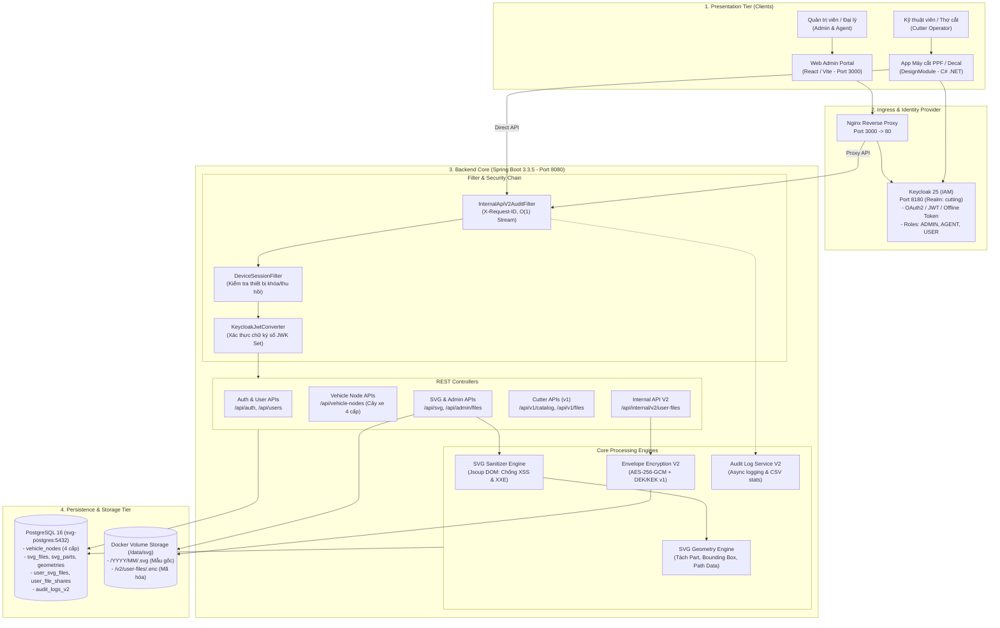

# 📐 Tài liệu Kiến trúc & Flow Hệ thống PCUT (PlantUML & Diagrams)

Thư mục này chứa toàn bộ tài liệu kiến trúc hệ thống và biểu đồ luồng hoạt động (Sequence Flows) của hệ sinh thái **PCUT Admin & Cutting Engine**, được mô tả bằng định dạng **PlantUML** chuẩn (`.puml`) sẵn sàng để lưu trữ và version control trên GitHub.

---

## 🗂️ Danh mục các file PlantUML

| Tên File | Loại Biểu đồ | Mô tả chi tiết |
| :--- | :--- | :--- |
| **[`system-architecture.puml`](./system-architecture.puml)** | Component / Architecture | Kiến trúc tổng thể toàn bộ hệ thống: Web Admin, App máy cắt thợ, Nginx, Spring Boot Backend (Filter Chain, Controllers, Service Engines), Keycloak IAM, PostgreSQL 16 và Storage Volume. |
| **[`flow-auth-security.puml`](./flow-auth-security.puml)** | Sequence Flow | Luồng xác thực & ủy quyền: Đăng nhập OAuth2 / OpenID Connect Keycloak, cấp phát JWT / Offline Token (Remember Me), kiểm soát thiết bị (Device Session Tracking) và RBAC. |
| **[`flow-svg-upload-processing.puml`](./flow-svg-upload-processing.puml)** | Sequence Flow | Luồng nạp file mẫu SVG: Khử độc chống Stored XSS / XXE (Jsoup DOM), bóc tách Part & tọa độ hình học vector (`SvgImport`), lưu trữ file và gắn liên kết cây xe 4 cấp. |
| **[`flow-internal-v2-encrypted.puml`](./flow-internal-v2-encrypted.puml)** | Sequence Flow | Phân hệ Internal API V2: Lưu trữ bản vẽ người dùng mã hóa đa tầng Envelope Encryption (AES-256-GCM), cơ chế ghi vết Zero-Intrusive Audit Log ($O(1)$ memory) và chia sẻ bản vẽ. |
| **[`flow-cutter-catalog-v1.puml`](./flow-cutter-catalog-v1.puml)** | Sequence Flow | API app thợ máy cắt (`/api/v1/*`): Tra cứu cây xe 4 cấp (`BRAND › SERIES › MODEL › SUBTYPE`), lọc danh mục, tìm kiếm file và tải dữ liệu hình học vector để điều khiển dao cắt PPF/decal. |

---

## 🖥️ Hướng dẫn xem & xuất hình ảnh PlantUML

### 1. Xem trực tiếp trong IDE
- **IntelliJ IDEA:** Cài plugin **PlantUML Integration** từ JetBrains Marketplace. Mở bất kỳ file `.puml` nào, cửa sổ preview sẽ hiển thị tự động bên phải.
- **VS Code:** Cài extension **PlantUML** của tác giả *jebbs*. Nhấn `Alt + D` (hoặc `Option + D` trên Mac) để xem preview.

### 2. Xuất ra ảnh PNG / SVG bằng Command Line
Nếu máy tính đã cài đặt PlantUML (`brew install plantuml` hoặc dùng Docker):
```bash
# Xuất tất cả các biểu đồ sang định dạng PNG
plantuml docs/architecture/*.puml -tpng

# Hoặc xuất sang định dạng SVG (vector sắc nét)
plantuml docs/architecture/*.puml -tsvg
```

### 3. Xem trực tuyến (Online)
Bạn có thể copy nội dung bất kỳ file `.puml` nào và dán vào [PlantUML Online Server](http://www.plantuml.com/plantuml/uml/) để xem hoặc chia sẻ liên kết tức thì.

---

## 📊 Xem nhanh Biểu đồ Kiến trúc (GitHub Mermaid Native Preview)

> *Biểu đồ dưới đây được render tự động ngay trên giao diện web của GitHub bằng cú pháp Mermaid:*


